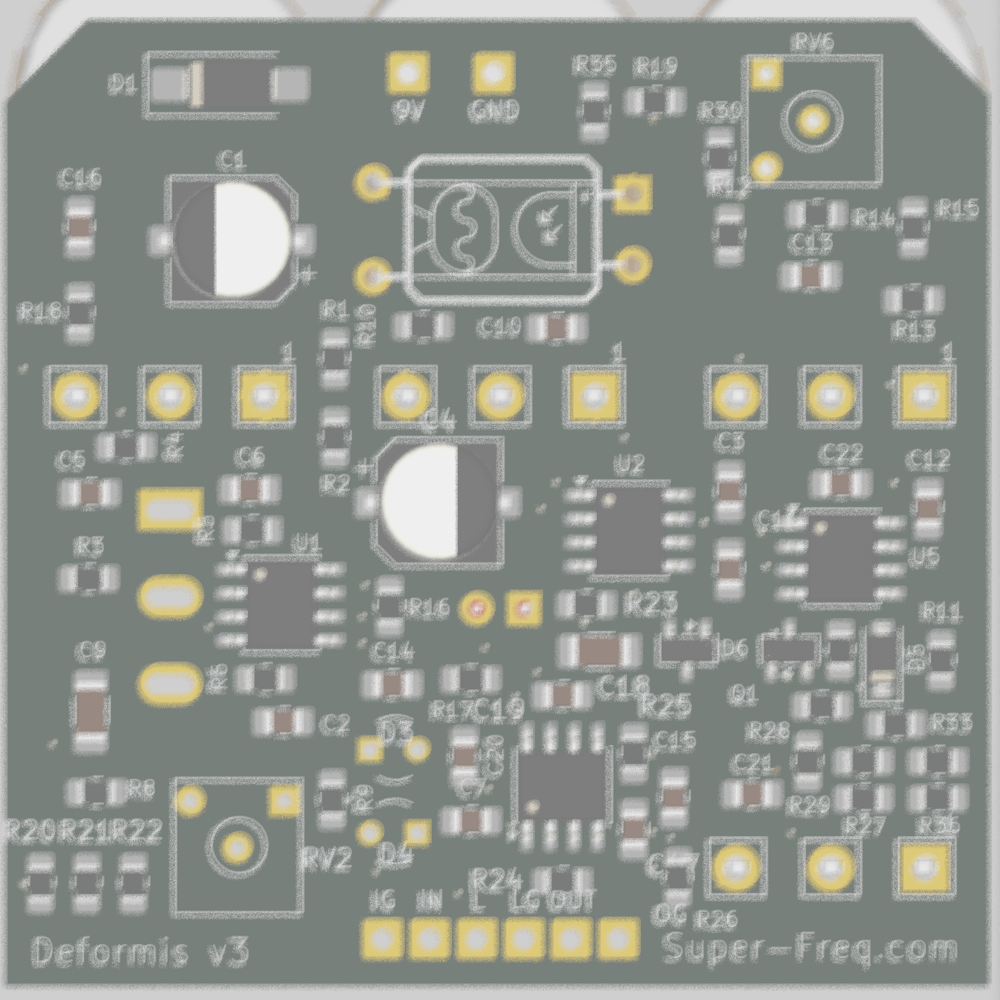

# Ugly Face 3 (SMD)

*Silkscreen name: Deformis v2.*

A gated, envelope-controlled square-wave synth fuzz for guitar, in a Hammond 1590B. A TL072 preamp (gain 201) gates and bends a TLC555 oscillator, with a **MIX** control to blend the dry fuzz with the synth tone. SMD parts are assembled by JLCPCB; the pots, LED, vactrol and wiring are hand-soldered.



## How it works

The guitar is amplified ×201 by U1A into a clipped square, which then does three things:

1. **Gate.** It's AC-coupled onto the 555's RESET pin. THRESHOLD sets the bias around the 555's ~1.0 V reset point, so the oscillator switches on and off every guitar cycle and restarts in step with the note (hard sync).
2. **Pitch bend.** It lights a DIY vactrol (LED + LDR). The LDR sits across the 555's timing resistance, so playing harder raises the pitch.
3. **Dry path.** It feeds the MIX control. U1B sums the dry fuzz and the 555 square (×4.1) → VOLUME → OUT.

Schematic: [UglyFace_03_schematic.pdf](UglyFace_03_schematic.pdf) · Layout: [UglyFace_03_layout.pdf](UglyFace_03_layout.pdf)

## Controls

| Knob | Part | Function |
|---|---|---|
| ENVELOPE | RV1 A10k (v1.3; v1.1 B1k) | How much the playing level drives the vactrol (pitch bend); fully CCW = off |
| THRESHOLD | SW1 toggle (v1.1) | GATED / GLITCH / ON. GLITCH sits on the 555's reset threshold, set once with the RV2 trimmer |
| FREQUENCY | RV3 C100k | Oscillator pitch (measured ~33 Hz to ~5 kHz) |
| MIX | RV4 B10k | Clean guitar (v1.1) ↔ synth square |
| VOLUME | RV5 A100k | Output level |

## Build notes

- **Hand-soldered:** four Alpha 16 mm pots, the THRESHOLD toggle (Taiway 100 ON-OFF-ON), the RV2 3362P 10k trimmer, the 3 mm LED (D2), the DIY vactrol U3 (LED + LDR in heat-shrink or a light-tight box), and the wire pads (9V/GND, IN/IG, OUT/OG, LED−/LG).
- **v1.0 boards only, recommended mod:** tack a **100 µF electrolytic across C4** (+ to VB, the MIX pot's middle-pin side). The stock 22 µF ceramic loses capacitance at 4.4 V. Without the mod, oscillator ripple on VB feeds back through the gain-201 preamp into the gate, and THRESHOLD becomes very sticky (on at 75%, off at 25%).
- Power: 9 V centre-negative; SS14 series reverse-polarity protection; ~4.3 mA (+ ~3.5 mA LED).

## Status

- **v1.1 (2026-10-03, JLC files generated):** C4 100 µF, 22k into RESET, RC-filtered 555 supply, C7 2.2 µ, C12/C13 1 µ, clean dry path (U4A) for MIX, buffered VB (U4B), THRESHOLD toggle + GLITCH trimmer. Details in [docs/Build Notes.md](docs/Build%20Notes.md).
- **v1.3 (2026-10-19, JLC files generated, not ordered):** new envelope (U5 LM358 detector from the clean DRY_OUT, Q1 current sink for the vactrol LED, DECAY trimmer RV6), ENVELOPE pot A10k, BAT54S RESET clamp, R21 15k, R13 220k, slotted Taiway footprint. Details: [docs/v1.3 Envelope.md](docs/v1.3%20Envelope.md).

- Boards received from JLCPCB 2026-10-01; bench tested 2026-10-02; **working with a guitar.** Measurements: [docs/Test Procedure.md](docs/Test%20Procedure.md).
- **Known issues (v1.0) / next revision** ([docs/Build Notes.md](docs/Build%20Notes.md)):
  - C4 → 100 µF.
  - FREQUENCY low end too low (33 Hz); C10 470n ceramic behaves like ~235n under bias, so use a film/C0G cap and retune.
  - Envelope weak (LDR choice / LED drive).
  - C12/C13 coupling caps cut below ~100 Hz.
  - Series resistor on the 555 RESET pin (CMOS protection; the pin is driven below ground every cycle).
  - THRESHOLD could become a 3-position switch.
- Ideas for the family: [Ugly Face Roadmap.md](Ugly%20Face%20Roadmap.md).

## Repository layout

```
UglyFace_03.kicad_pro / .kicad_sch / .kicad_pcb / .kicad_dru   KiCad 10 project
UglyFace.pretty/, fp-lib-table                              project footprints
3dmodels/        pot and enclosure models (${KIPRJMOD})
docs/            test procedure (with measurements) and build notes
enclosure/       panel art (Affinity + PDF/SVG exports)
*.pdf, *.png     schematic, layout and renders
```

Opens with KiCad 10. Libraries and 3D models are project-local or from KiCad's standard library.
